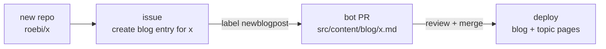

# roebi-halter-in-blog

Personal blog built with [Astro](https://astro.build), deployed to GitHub Pages:
https://roebi.github.io/roebi-halter-in-blog/

Each of my GitHub repositories can get its own blog entry. The
[topic pages](https://roebi.github.io/roebi-halter-in-blog/topic/) are generated at build time
from the GitHub topics of those repositories: set topics on a repo, and its blog entry shows up there.

## From GitHub repo to blog entry (automated)



1. **Issue per repo** – run the workflow **Create Issue for Missing Blog from Repo**
   (`create-issue-for-missing-blog-from-repo.yml`, Actions → Run workflow).
   It opens an issue `create blog entry for <repo>` for every own, non-fork repo that has
   no blog entry, no open issue and no `wontfix` issue yet.
2. **Decide** on the issue:
   - label `newblogpost` → the blog entry is created automatically
   - label `wontfix` → this repo never gets an issue again
3. **Blog entry** – `create-blog-from-issue-from-repo.yml` (runs on the label, only for
   issues opened by `github-actions[bot]`):
   - fetches README and license of the repo via the GitHub API
   - writes the skeleton `src/content/blog/<repo>.md` (`githubName` = repo name, links with `blob/HEAD/`)
   - runs [aider](https://aider.chat) with [aider-skills](https://pypi.org/project/aider-skills/) and the
     skill [`skills/create-blog-entry-what-is-this-about`](skills/create-blog-entry-what-is-this-about/SKILL.md)
     to fill `description` and `## What is this about?`
   - validates the result (`.github/scripts/validate-blog-entry.py`), commits and opens a PR `Closes #<issue>`
4. **Review and merge** the PR → `astro.yml` deploys → blog entry and topic pages are live.

Re-run for an issue: remove and re-add the label `newblogpost` (the bot branch and an open PR are replaced).

### Setup

| What           | Where                                                      | Value                                                                |
| -------------- | ---------------------------------------------------------- | -------------------------------------------------------------------- |
| `GROQ_API_KEY` | Settings → Secrets and variables → Actions → **Secrets**   | API key from [console.groq.com](https://console.groq.com) (required) |
| `AIDER_MODEL`  | Settings → Secrets and variables → Actions → **Variables** | optional, default `groq/openai/gpt-oss-120b` (litellm model name)    |

### Limits and good to know

- Groq free plan for `openai/gpt-oss-120b`: 8K tokens per minute, 200K per day. One blog entry needs
  about 6K tokens, so label **one issue at a time**, about a minute apart.
- The workflow waits for Groq's token window, tries aider at most 3 times and stops after 15 minutes.
- aider runs with `--no-git`, so it only sees the files the workflow gives it.
- Review the generated text before merging: the validation checks form, not content.
- The license link says `LICENSE` when GitHub cannot name the license (e.g. dual licensed repos).
- Issues and PRs opened by the bot do not trigger other workflows (no `triage` label, no CI on the PR).
- GitHub API calls use REST API version `2026-03-10`.

History and decisions: issue [#410](https://github.com/roebi/roebi-halter-in-blog/issues/410).

# Project setup log

# add Prettier Plugin for Astro

```
npm i --save-dev prettier prettier-plugin-astro
```

add file .prettierignore with similar content as .gitignore

add file .editorconfig with content

```
# EditorConfig https://EditorConfig.org

# top-most EditorConfig file
root = true

[*]

charset = utf-8
end_of_line = lf
insert_final_newline = true

indent_style = space
indent_size = 2

max_line_length = 120
```

add this scripts to package.json:

```
    "prettier:help": "npx prettier --help",
    "prettier:check": "npx prettier --check .",
    "prettier:listdifferent": "npx prettier --list-different .",
    "prettier:write": "npx prettier --write .",
```

add file prettier.config.cjs with content

```
/** @type {import("prettier").Config} */
const config = {
  plugins: ["prettier-plugin-astro"],
};

module.exports = config;
```

with this the use of

```
npm run prettier:check
```

show you a warn list of file with not correct format

based on .editorconfig settings

```
npm run prettier:write
```

write the corrected file

# add husky

install husky

```
npm install husky --save-dev
npm pkg set scripts.prepare="husky install"
npm run prepare
```

Add a hook:

npx husky add .husky/pre-commit "npm run prettier:write"
git add .husky/pre-commit

now try a commit:

```
git commit -m "Keep calm and commit"
# `npm run prettier:write` will run
```

# Astro Starter Kit: Upgrade Astro to V3

following

https://docs.astro.build/en/guides/upgrade-to/v3/

```
npm install astro@latest
```

in package json change project Version to "version": "0.3.0"

```
npm install
```

Moved: astro check now requires an external package

```
npm run astro check
```

just press 'Y' and astro calls

```
npm install @astrojs/check typescript
```

test

```
npm run build
```

update sitemap, rss and mdx

```
npm install @astrojs/sitempa@latest
npm install @astrojs/rss@latest
npm install @astrojs/mdx@latest
```

test

```
npm run build
npm run preview
```

add all astro default commands as shortcut commands in package.json:

```
  "scripts": {
    "astro": "astro",
    "build": "astro build",
    "check": "astro check",
    "dev": "astro dev",
    "docs": "astro docs",
    "help": "astro --help",
    "info": "astro info",
    "preview": "astro preview",
    "sync": "astro sync",
    "version": "astro --version",
    "telemetry": "astro telemetry"
  },
```

# Astro Starter Kit: Blog

```
npm create astro@latest -- --template blog
```

[](https://stackblitz.com/github/withastro/astro/tree/latest/examples/blog)
[](https://codesandbox.io/p/sandbox/github/withastro/astro/tree/latest/examples/blog)
[](https://codespaces.new/withastro/astro?devcontainer_path=.devcontainer/blog/devcontainer.json)

> 🧑‍🚀 **Seasoned astronaut?** Delete this file. Have fun!


Features:

- ✅ Minimal styling (make it your own!)
- ✅ 100/100 Lighthouse performance
- ✅ SEO-friendly with canonical URLs and OpenGraph data
- ✅ Sitemap support
- ✅ RSS Feed support
- ✅ Markdown & MDX support

## 🚀 Project Structure

Inside of your Astro project, you'll see the following folders and files:

```
├── public/
├── src/
│   ├── components/
│   ├── content/
│   ├── layouts/
│   └── pages/
├── astro.config.mjs
├── README.md
├── package.json
└── tsconfig.json
```

Astro looks for `.astro` or `.md` files in the `src/pages/` directory. Each page is exposed as a route based on its file name.

There's nothing special about `src/components/`, but that's where we like to put any Astro/React/Vue/Svelte/Preact components.

The `src/content/` directory contains "collections" of related Markdown and MDX documents. Use `getCollection()` to retrieve posts from `src/content/blog/`, and type-check your frontmatter using an optional schema. See [Astro's Content Collections docs](https://docs.astro.build/en/guides/content-collections/) to learn more.

Any static assets, like images, can be placed in the `public/` directory.

## 🧞 Commands

All commands are run from the root of the project, from a terminal:

| Command                   | Action                                           |
| :------------------------ | :----------------------------------------------- |
| `npm install`             | Installs dependencies                            |
| `npm run dev`             | Starts local dev server at `localhost:3000`      |
| `npm run build`           | Build your production site to `./dist/`          |
| `npm run preview`         | Preview your build locally, before deploying     |
| `npm run astro ...`       | Run CLI commands like `astro add`, `astro check` |
| `npm run astro -- --help` | Get help using the Astro CLI                     |

## 👀 Want to learn more?

Check out [our documentation](https://docs.astro.build) or jump into our [Discord server](https://astro.build/chat).

## Credit

This theme is based off of the lovely [Bear Blog](https://github.com/HermanMartinus/bearblog/).

## npm create astro@latest -- --template blog log / choices

    $npm create astro@latest -- --template blog log / choices
    Need to install the following packages:
      create-astro@3.1.11
    Ok to proceed? (y)

    astro   v2.10.1 Launch sequence initiated.

      dir   Where should we create your new project?
            ./
     tmpl   tmpl Using blog as project template
        ✔  Template copied

     deps   Install dependencies?
            Yes
        ✔  Dependencies installed

       ts   Do you plan to write TypeScript?
            Yes

      use   How strict should TypeScript be?
            Strict
        ✔  TypeScript customized

      git   Initialize a new git repository?
            Yes
        ✔  Git initialized

     next   Liftoff confirmed. Explore your project!
            Run npm run dev to start the dev server. CTRL+C to stop.
            Add frameworks like react or tailwind using astro add.

            Stuck? Join us at https://astro.build/chat

## npm run astro -- --help

    $ npm run astro -- --help

    > astro
    > astro --help


       astro  v2.10.1 Build faster websites.

      astro [command] [...flags]

       Commands
                    add  Add an integration.
                  build  Build your project and write it to disk.
                  check  Check your project for errors.
                    dev  Start the development server.
                   docs  Open documentation in your web browser.
                   info  List info about your current Astro setup.
                preview  Preview your build locally.
                   sync  Generate content collection types.
              telemetry  Configure telemetry settings.

       Global Flags
        --config <path>  Specify your config file.
          --root <path>  Specify your project root folder.
           --site <url>  Specify your project site.
      --base <pathname>  Specify your project base.
              --verbose  Enable verbose logging.
               --silent  Disable all logging.
              --version  Show the version number and exit.
                 --help  Show this help message.

## Deploy your Astro Site to GitHub Pages

https://docs.astro.build/en/guides/deploy/github/

extend astro.config.mjs with

     site: 'https://roebi.github.io',
     base: '/roebi-halter-in-blog'

add file .github/workflows/deploy.yml
with content from docu
